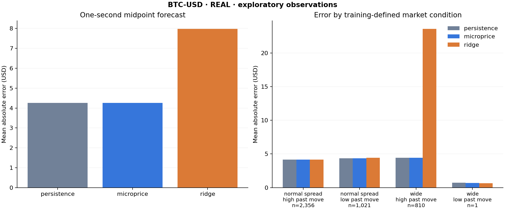

# MicropriceLab

**Does size-weighted top-of-book microprice forecast the observed midpoint one second ahead better than midpoint persistence?** This repository makes the question reproducible: verified public-market captures, causal sampling, earlier-day training, later-day evaluation, explicit failure exclusions, and auditable forecasts.

The included real-data run is a **two-date smoke study**, not an established trading edge. It uses a short October 7 capture and a new ten-minute October 8 capture of Coinbase BTC-USD. The software is ready for longer collection; the evidence is still small.



## Run it

Python 3.10+; a C++20 compiler and Make are needed only for new live captures. No exchange account, API secret or order submission is used.

```bash
python3 -m venv .venv
source .venv/bin/activate
python -m pip install -r requirements.txt
make test
python -m micropricelab demo
python -m micropricelab study data/observations/20261007.csv data/observations/20261008.csv --output reports/reproduced-real
```

The demo generates four **synthetic** dates with a planted relationship. Its output is deliberately separated from real data. The study rejects attempts to pool real and synthetic observations, repeat an input, overlap capture sessions, mix products, or load a changed CSV fingerprint.

Open `reports/reproduced-real/index.html`. `report.json` includes each fold's training dates, feature scaling, coefficients, training-only condition thresholds, input fingerprints and exclusions. `predictions.csv` contains individual forecasts. The same data support a less-overlapping sensitivity run:

```bash
python -m micropricelab study data/observations/20261007.csv data/observations/20261008.csv --step-ms 1000 --output reports/nonoverlapping
```

## Collect the study that is worth presenting

Collect at least 30 minutes on each of **5–7 separate UTC dates**, preferably at comparable times with some different activity conditions. Choose the collection plan and model settings before examining the later dates. More coverage would be better; a handful of dates remains exploratory.

```bash
python -m micropricelab capture --hours .5 --output data/captures
# Repeat on later dates. Each call creates new, uniquely named sessions.
python -m micropricelab study data/captures/observations/*.csv --train-days 2 --output reports/multiday
```

The runner builds your existing collector, uses 15-minute immutable journals, stops on a collector error, and enforces a total on-disk budget. It keeps verified committed data after an error; inspect the journal's `.summary.json` before deciding whether that session belongs in the study. It does not silently turn failed live collection into simulated data. Terminal shutdown stops collection; use your own machine's terminal/session management for longer runs.

### Where the data come from

`vendor/mdpipe` is a copy of **Thomas Krane's existing market-data-pipeline**, under its original MIT license. Its C++ book, async transport, trust gate and hash-chained SQLite journal are reused rather than presented as new work. MicropriceLab adds research import, timing discipline, sampling, modeling, evaluation and reports.

The public feed sends aggregated Level 2 snapshots and absolute level quantities. See Coinbase's [WebSocket endpoints](https://docs.cdp.coinbase.com/coinbase-app/advanced-trade-apis/websocket/websocket-endpoints) and [Level 2 schema](https://docs.cdp.coinbase.com/api-reference/advanced-trade-api/websocket/level2). These data do not reveal individual orders, queue position or hidden liquidity.

Regenerate the trusted observations from the included original journals:

```bash
python -m micropricelab import-journal data/real/live-baseline.sqlite --provenance real --output data/reimported/20261007.csv
python -m micropricelab import-journal data/real/capture-20261008.sqlite --provenance real --output data/reimported/20261008.csv
```

## Method

For best bid `b`, best ask `a`, displayed bid size `Vb` and ask size `Va`:

```text
mid       = (a + b) / 2
micro     = (a * Vb + b * Va) / (Vb + Va)
imbalance = (Vb - Va) / (Vb + Va)
target    = observed_mid(t + 1 second) - observed_mid(t)
```

This is a snapshot size-weighted BBO microprice proxy. It is not a fitted multi-state market microstructure model.

1. Verify every journal row's order and hash chain. Import only trusted publications. An invalidated command or recorded fault fences the subsequent research segment.
2. Use the **local publication-record timestamp**, captured after the quote callback, as a conservative availability clock. Source arrival time is retained but is not used to make features available early. This is not exchange event time, and callback/record timing is not infinitely precise.
3. Sample on a 100ms UTC grid with causal as-of lookup: use only the last quote available at or before the decision time. The label is the last observed published state at or before exactly `t+1s`, not a quote selected after that target.
4. Require the decision quote, label quote and lag quote to be no more than 250ms old. Split at publication gaps over 500ms; exclude labels crossing gaps, captures, reconnect generations, invalidation fences, UTC dates, or evaluation boundaries. Require a one-second lag inside the same valid span.
5. Compare zero-change persistence, `micro-mid`, and a four-feature ridge change forecast using micro-minus-mid, imbalance, past-one-second return and spread. Standardize only on training rows. Fix the penalty at 10 for the unnormalized sum-of-squares objective; do not select it using test results.
6. Train on earlier UTC dates and evaluate on each later date with expanding training history. Purge labels at the evaluation boundary. Report MAE, RMSE and bias in quote-currency units by day and by spread/recent-movement condition. Condition cutoffs are the training 75th percentiles, not test quantiles. Spread subtraction is rounded to the source's 1e-8 fixed-point precision.
7. Keep individual predictions and training-range diagnostics. A wider-spread or fast-moving test period can be outside what the training set represented; that is a failure mode worth reporting.

The 100ms grid produces overlapping one-second labels. Overall errors are sample-weighted. The optional paired uncertainty estimate uses an **equal-day-weighted** MAE improvement, resampling evaluation days and then 60-second blocks within those days. It requires at least two evaluation dates with five blocks each; it never reports an iid-row interval. These minima do not make a small study conclusive or guarantee independent days.

The freshness/publication-gap filter is conservative: a quiet but healthy market period can be excluded even without a sequence gap. These are gaps in observed publications, not proved feed losses. Error metrics therefore describe retained fresh observations, with possible activity-selection bias. A useful later extension is heartbeat-aware quote validity, evaluated as a separate predeclared sampling policy.

## What the initial data say

Read [the measured findings](reports/real-smoke/FINDINGS.md). Microprice slightly reduced MAE but did not reduce RMSE. The fitted model failed badly in wider-spread conditions after training on a tiny, mostly one-cent-spread period. No confidence interval or profitable-strategy claim is made.

Better forecast error is only an intermediate result. An executable strategy would additionally need an explicit decision rule, bid/ask execution prices, fees, queue/fill assumptions, latency, adverse selection, inventory limits and a separate untouched evaluation. Buying at the future or current midpoint would not be a valid fill model.

## Checks and useful next work

`make test` verifies the microprice formula, causal availability, reconnect/gap fences, stale observations, midnight label purging, training-only preprocessing, constant-feature stability, blocked inference requirements, provenance, corruption rejection and deterministic expanding-day evaluation.

The best next change is **more real observations**, followed by explaining model extrapolation and testing predeclared sensitivity settings. Resist adding many features before collecting enough independent periods. Keep this repository as one research project and acknowledge the shared collector if the pipeline also appears on the resume.
